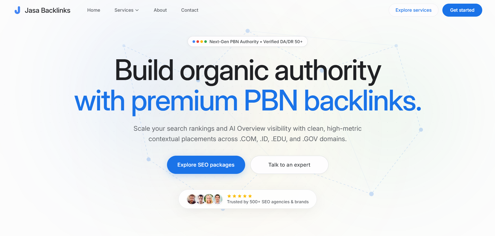

# Jasa Backlinks 

  

**Portfolio Showcase:** This repository demonstrates the frontend and backend architecture developed for Jasa Backlinks, a premium SEO and link-building brand operating under SeoHub Ltd. It serves as a technical case study of a commercial web application, highlighting the implementation of a real-time cost estimator, a seamless multi-step checkout flow, and automated backend logistics. 

## Project Overview

Jasa Backlinks provides high-authority (DA/DR 50+) contextual placements across global .COM, .ID regional, and .EDU/.GOV networks. The primary engineering objective of this application was to transition the business from manual invoice generation to a fully automated, scalable, and highly converting self-service SaaS portal.

The platform is engineered with a strict minimalist aesthetic inspired by enterprise software, ensuring a frictionless user experience from package selection to post-payment onboarding.

## Core Architecture & Features

**Interactive Bulk Estimator**
A real-time calculation engine built in React that allows users to aggregate multiple placement packages into a single custom bundle with instantaneous pricing updates and subtotal calculations.

**Multi-Stage Modal Checkout Flow**
A completely asynchronous, popup-based architecture preventing page reloads and ensuring maximum conversion retention:
1. **Payment Gateway Integration:** Secure transaction processing using Stripe Elements (custom card primitives), PayPal Smart Buttons, and BoomFi Crypto API.
2. **Campaign Intake:** A mandatory post-payment onboarding module capturing target URLs, anchor texts, and communication preferences seamlessly.
3. **Confirmation & Handoff:** A smooth success transition displaying verifiable transaction metadata and direct project management contacts.

**Automated Email Dispatch System**
A secure Node.js backend utilising Nodemailer configured with custom SMTP. It is programmed to concurrently dispatch responsive, custom-coded HTML receipts to clients and detailed payload alerts to the administrative team immediately upon successful payment capture.

**Responsive UI Engineering**
Custom-built native touch sliders, collapsible specification modules, and sticky summary interfaces specifically optimised for diverse viewport sizes without relying on heavy external UI libraries.

## Technology Stack

**Frontend Architecture:**
* React.js (Vite)
* Tailwind CSS
* React Router DOM
* Stripe Elements (@stripe/react-stripe-js)
* PayPal JS SDK (@paypal/react-paypal-js)
* Axios

**Backend Architecture:**
* Node.js & Express.js
* Stripe Node SDK
* Nodemailer
* Zod request validation, Helmet security headers, and rate limiting
* CORS & Dotenv

## Payment Webhook Configuration

Configure provider credentials in the backend environment before enabling live payments:

* Stripe: `STRIPE_SECRET_KEY` and `STRIPE_WEBHOOK_SECRET`.
* PayPal: `PAYPAL_CLIENT_ID`, `PAYPAL_CLIENT_SECRET`, and the webhook ID from the PayPal app's webhook configuration as `PAYPAL_WEBHOOK_ID`. Set `PAYPAL_BASE_URL` to the matching sandbox or live API base.
* BoomFi: `BOOMFI_API_KEY`, the RSA webhook signing public key from the dashboard as `BOOMFI_WEBHOOK_PUBLIC_KEY`, and the merchant organization ID as `BOOMFI_ORG_ID`. Preserve PEM newlines (or encode them as `\n`); webhook deliveries are verified against their original raw request body and a five-minute timestamp window.
* Order email: `RESEND_API_KEY` (or the existing `SMTP_PASS` alias), with optional `SENDER_EMAIL` and `ADMIN_EMAIL` addresses.

PayPal and BoomFi webhook endpoints reject unsigned deliveries. Register `/api/webhooks/paypal` and `/api/webhooks/boomfi` with their respective providers. Run backend unit tests with `npm test --prefix backend`.

## Developer Note

This application was architected and developed by **Rafay** as part of the digital infrastructure for SeoHub Ltd. It demonstrates full-stack capabilities, particularly in integrating complex third-party payment gateways, managing secure API states, structuring scalable React components, and crafting high-conversion user interfaces.

*Copyright SeoHub Ltd. The source code is proprietary and showcased strictly for professional portfolio and architectural demonstration purposes.*
